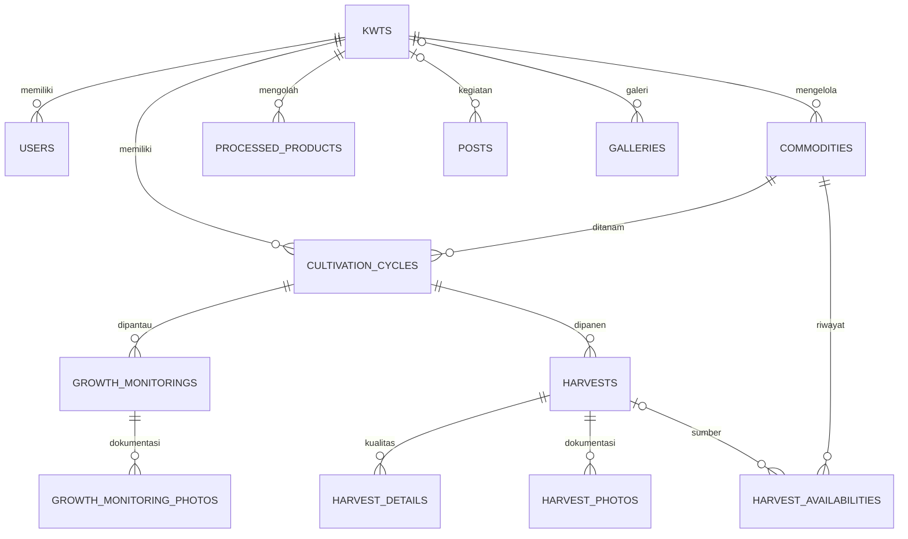

# Laporan implementasi KWT Kota Tangerang

Implementasi 7 September 2026. Panduan instalasi dan akun ada di [README](../README.md).

## 1. Arsitektur

Satu aplikasi Laravel 12 dengan Eloquent dan MySQL. Blade merender halaman publik serta panel admin; Tailwind CSS 4/Vite membangun aset. JavaScript native menangani drawer mobile, dialog konfirmasi, pemilihan periode grafik, dan detail grade panen. Tidak ada React terpisah.

Request melewati autentikasi dan `ActiveUser`, Form Request, Policy/Gate, controller, lalu service untuk perhitungan dan perubahan multi-tabel. Model scope membatasi daftar data berdasarkan KWT; policy memeriksa setiap akses record. Pengaturan publik berasal dari database.

## 2. Struktur folder penting

```text
app/
  Http/Controllers/     Halaman publik, autentikasi, CRUD, budidaya, laporan
  Http/Requests/        Validasi resource, monitoring, panen, filter
  Http/Middleware/     ActiveUser
  Models/              Eloquent dan relasi domain
  Policies/            DomainPolicy
  Services/            Perhitungan, availability, laporan, WhatsApp, XLSX, audit
  Support/Resources.php Definisi field CRUD dan label Indonesia
database/
  migrations/          Skema, foreign key, indeks, soft delete
  seeders/             Tiga KWT dan data demo workflow
resources/
  views/components/    Layout, field, filter, badge, kartu komoditas
  views/public/        Website masyarakat
  views/admin/         Panel pengelola
  views/auth/          Login
  css/app.css          Tampilan responsive dan print
  js/app.js            Interaksi UI native
lang/id/               Validasi dan pagination Indonesia
public/images/         Ilustrasi SVG lokal
routes/web.php         Route aplikasi
storage/app/private/   Foto monitoring dan panen
storage/app/public/    Logo, cover, katalog, kegiatan, galeri
tests/Feature/         Pengujian workflow dan keamanan
scripts/               Pemeriksaan browser melalui CDP
```

## 3. Tabel database

| Kelompok | Tabel |
|---|---|
| Organisasi dan akses | `users`, `kwts` |
| Master | `commodity_categories`, `commodities`, `processed_product_categories` |
| Budidaya | `cultivation_cycles`, `growth_monitorings`, `growth_monitoring_photos` |
| Panen | `harvests`, `harvest_details`, `harvest_photos` |
| Ketersediaan | `harvest_availabilities` |
| Katalog dan publikasi | `processed_products`, `posts`, `galleries` |
| Pengaturan dan jejak perubahan | `settings`, `audit_logs` |
| Infrastruktur Laravel | `migrations`, `password_reset_tokens`, `sessions`, `cache`, `cache_locks`, `jobs`, `job_batches`, `failed_jobs` |

`kwts`, `commodities`, `cultivation_cycles`, `harvests`, `processed_products`, dan `posts` menggunakan SoftDeletes. Field relasi memiliki foreign key. Kode/slug unik; nomor urut panen unik per siklus. Tanggal dan status utama diindeks. Hasil panen disimpan dengan presisi empat angka desimal.

Tidak dibuat tabel order, pelanggan, payment, cart, shipping, sales, atau transaksi jual-beli.

## 4. Relasi



Availability terbaru merupakan snapshot total komoditas pada suatu KWT, bukan jumlah seluruh snapshot historis. Satuan komoditas tidak dapat diubah setelah ada aktivitas.

## 5. Role

- `super_admin`: seluruh sistem, pengguna, pengaturan, dan izin input khusus.
- `admin_koperasi`: membaca seluruh data; mengelola KWT, kegiatan, galeri, ketersediaan, kategori, dan pengaturan. Aktivitas produksi hanya dapat ditulis bila `can_manage_cultivation=true`.
- `admin_kwt`: profil KWT sendiri, komoditas, siklus, monitoring, foto, panen, ketersediaan, olahan, kegiatan, galeri, dan laporan sendiri.

Input `kwt_id` dari Admin KWT selalu diganti dengan KWT pada akun. Pemilihan komoditas untuk siklus divalidasi terhadap izin pengguna. Akun/KWT nonaktif tidak dapat masuk ke panel. Pengguna hanya dikelola Super Admin.

## 6. Route

| Method | Route | Fungsi |
|---|---|---|
| GET | `/` | Beranda |
| GET | `/tentang`, `/kontak` | Informasi koperasi |
| GET | `/kwt`, `/kwt/{slug}` | Direktori/profil KWT |
| GET | `/komoditas`, `/komoditas/{slug}` | Komoditas aktif/detail |
| GET | `/sedang-ditanam`, `/segera-panen`, `/ready` | Pintasan filter katalog |
| GET | `/jadwal-panen` | Jadwal, proyeksi, filter periode/wilayah |
| GET | `/produk-olahan`, `/produk-olahan/{slug}` | Katalog olahan |
| GET | `/kegiatan`, `/kegiatan/{slug}` | Publikasi kegiatan |
| GET | `/whatsapp/{kind}/{id}?quantity=...` | Membentuk redirect WhatsApp |
| GET | `/foto/{kind}/{id}` | Foto dengan pemeriksaan izin |
| GET / POST | `/login` | Form dan autentikasi |
| POST | `/logout` | Mengakhiri sesi |
| GET | `/admin` | Dashboard sesuai role |
| GET / POST | `/admin/account` | Nama dan kata sandi sendiri |
| GET / POST | `/admin/settings` | Pengaturan koperasi |
| GET | `/admin/reports` | Laporan, print, `export=xlsx` |
| GET | `/admin/harvests`, `/admin/monitorings` | Daftar aktivitas |
| GET | `/admin/cycles/{id}` | Detail, timeline, form aktivitas |
| POST | `/admin/cycles/{id}/monitorings` | Monitoring/foto/proyeksi |
| POST | `/admin/cycles/{id}/harvests` | Panen/grade/foto/availability |
| DELETE | `/admin/harvests/{id}` | Koreksi panen |
| POST | `/admin/commodities/{id}/availability` | Snapshot ketersediaan |
| DELETE | `/admin/photos/{kind}/{id}` | Hapus foto |
| GET / POST | `/admin/manage/{resource}` | Daftar/simpan resource |
| GET | `/admin/manage/{resource}/create` | Form tambah |
| GET | `/admin/manage/{resource}/{id}/edit` | Form edit |
| PUT / DELETE | `/admin/manage/{resource}/{id}` | Update/hapus resource |

`resource`: `kwts`, `commodities`, `cycles`, `products`, `posts`, `galleries`, `users`, `commodity-categories`, `product-categories`. Controller menerima daftar resource eksplisit, bukan nama model/tabel bebas dari URL. Daftar route konkret tersedia melalui `php artisan route:list --except-vendor`.

## 7. Controller

| Controller | Tanggung jawab |
|---|---|
| `AuthController` | Login, logout, akun |
| `PublicController` | Katalog, KWT, jadwal, kegiatan, WhatsApp |
| `ResourceController` | CRUD master dengan whitelist field dan authorization |
| `CultivationController` | Detail siklus, monitoring, panen, availability, foto |
| `DashboardController` | Ringkasan dan grafik sesuai lingkup role |
| `ReportController` | Filter periode, tampilan laporan, export |
| `SettingController` | Identitas koperasi, kontak, konfigurasi situs |

## 8. Service

- `CultivationCalculationService`: cadangan bibit, kebutuhan bibit, survival, ekspektasi, biaya, tanggal panen.
- `CultivationService`: pembuatan siklus, monitoring, foto, proyeksi terbaru.
- `HarvestCalculationService`: transaksi panen bertahap, realisasi, ketersediaan, pembatalan panen.
- `ProductAvailabilityService`: status publik komoditas dan pemilihan siklus yang relevan.
- `WhatsappMessageService`: pesan Ready, Pre-Order, dan produk olahan; URL encoding.
- `HarvestReportService`: data siklus per periode, grouping, subtotal, rekap, total per unit.
- `XlsxExportService`: XLSX menggunakan ekstensi PHP ZipArchive dan OOXML, tanpa dependensi Excel tambahan.
- `AuditService`: pencatatan aksi, pengguna, model, nilai sebelum/sesudah, IP. Password dan remember token tidak dicatat.

## 9. Policy, Gate, dan validasi

`DomainPolicy` dipakai bersama oleh model domain untuk `view`, `update`, `delete`. Gate `manage-users` dan `manage-settings` menjaga fungsi pusat. `ActiveUser` memeriksa akun dan KWT pada seluruh route panel.

`ResourceRequest`, `MonitoringRequest`, `HarvestRequest`, dan `FilterRequest` menangani field master, tenant, tanggal, jumlah, persentase, foto, dan filter query. Autentikasi, akun, pengaturan, laporan, serta pembaruan availability menggunakan validasi Laravel pada endpoint masing-masing.

Proteksi lain: CSRF, hash password, regenerasi sesi, throttling login/WhatsApp, escape Blade, MIME/ukuran upload, foreign key, snapshot satuan, dan transaksi database. Foto monitoring privat tidak tersedia lewat symlink publik. Foto panen hanya untuk pengguna yang diizinkan. Hanya caption dan foto monitoring bertanda publik yang masuk timeline masyarakat.

## 10. Perhitungan bibit

Dengan lubang tanam:

```text
cadangan = ceil(lubang_tanam × persen_cadangan / 100)
bibit_dibutuhkan = lubang_tanam + cadangan
bibit_ditanam = lubang_tanam
```

1.000 lubang + 10% = 100 cadangan, 1.100 kebutuhan bibit. Tanpa lubang, admin mengisi jumlah bibit, dengan jumlah ditanam opsional; jumlah ditanam tidak boleh melampaui bibit yang tersedia. Jumlah tanaman disimpan sebagai bilangan bulat.

## 11. Ekspektasi awal

```text
tanaman_produktif = floor(bibit_ditanam × target_hidup / 100)
ekspektasi_awal = tanaman_produktif × target_hasil_per_tanaman
```

1.000 × 90% × 0,30 = 270 kg. Satuan disalin dari master ke siklus. Nilai awal dan data pembibitan dikunci setelah pembuatan siklus.

## 12. Proyeksi terbaru

```text
umur_tanaman = tanggal_monitoring − tanggal_mulai
survival_terkini = tanaman_hidup / bibit_ditanam × 100
proyeksi = tanaman_sehat × estimasi_hasil_per_tanaman
```

870 × 0,29 = 252,3 kg. Monitoring terbaru dipilih berdasarkan tanggal monitoring lalu ID. Entri bertanggal lama tidak menggantikan proyeksi dari monitoring yang lebih baru. Ekspektasi awal tetap utuh.

## 13. Realisasi dan panen bertahap

```text
realisasi_total = SUM(usable_quantity panen yang tidak dihapus)
selisih = realisasi_total − ekspektasi_awal
capaian = realisasi_total / ekspektasi_awal × 100
```

Pembagi nol ditampilkan sebagai `—`. Dua panen 140 + 100 = 240 kg; terhadap 270 kg, capaian 88,89%, selisih −30 kg. Panen kotor harus mencukupi hasil layak + rusak. Tanggal panen tidak boleh sebelum mulai atau sesudah hari ini.

Transaksi database dan row lock per komoditas/siklus melindungi pembuatan panen, nomor urut, realisasi, serta availability. Pembatalan panen memakai soft delete dan menghitung ulang realisasi; ketersediaan terkini dikurangi hasil panen tersebut, minimum nol. Admin dapat menyesuaikan kembali jumlah aktual setelah koreksi.

## 14. Status produk dan availability

Prioritas publik:

1. KWT/komoditas nonaktif → Tidak Aktif.
2. Snapshot ketersediaan terbaru berstatus available/limited dengan jumlah > 0 → Ready.
3. Ada siklus aktif dengan pre-order diaktifkan → Pre-Order.
4. Siklus near_harvest atau tanggal mendekati batas `near_harvest_days` → Segera Panen.
5. Siklus seedling/growing → Sedang Ditanam.
6. Tidak ada siklus aktif dan pernah ada ketersediaan → Habis.
7. Tidak ada aktivitas → Tidak Aktif.

Katalog hanya menampilkan komoditas aktif secara publik. Draft, completed, failed, dan cancelled tidak membuka komoditas tanpa stok. Master tetap disimpan. Near-harvest berdasarkan tanggal dihitung untuk tampilan; tidak diam-diam menulis ulang status manual. Perubahan status oleh admin harus disertai alasan.

Pre-order juga dapat diaktifkan lebih awal pada siklus tumbuh sesuai kebutuhan KWT. `default_preorder_days` disimpan sebagai pengaturan referensi; tidak otomatis membuka pemesanan tanpa persetujuan pengelola siklus.

Availability merupakan snapshot total aktual per KWT/komoditas, bukan ledger penjualan. Menandai sold_out/not_available menyimpan jumlah nol. Histori snapshot tidak dijumlahkan menjadi stok. Penambahan panen menggunakan snapshot terakhir sebagai dasar.

## 15. WhatsApp

Nomor dibaca dari `settings.cooperative_whatsapp`, dibersihkan menjadi digit, dan awalan 0 diubah menjadi 62. Pesan di-encode menggunakan `rawurlencode` untuk `https://wa.me/{nomor}?text=...`.

Pesan Ready menyertakan nama komoditas, KWT, status, jumlah yang dibutuhkan, dan ketersediaan. Pesan Pre-Order menyertakan estimasi tanggal dan proyeksi panen. Produk olahan memiliki pesan sendiri. Jumlah divalidasi positif. Endpoint mengarahkan browser ke WhatsApp tanpa menyimpan transaksi pelanggan.

## 16. Laporan dan dashboard

Laporan mencakup siklus dengan **estimasi panen dalam periode ATAU transaksi panen dalam periode**. Tiap siklus hanya dihitung sekali, sekalipun memiliki beberapa transaksi panen.

- Ekspektasi/proyeksi: nilai penuh siklus terpilih.
- Realisasi: panen yang tanggalnya berada di periode.
- Subtotal: per KWT dan satuan.
- Rekap: nama komoditas, jumlah KWT unik, hasil per satuan.
- Total: terpisah untuk kg, gram, ikat, pcs, buah, pot, liter.
- Filter: tanggal, bulan/tahun, KWT, kecamatan, kelurahan, komoditas, pencarian.

Capaian periode dapat berbeda dari capaian akhir siklus yang panennya melintasi bulan. Definisi tersebut ditampilkan di halaman dan file export. Laporan tidak dipaginasi agar cetak/export memuat seluruh hasil filter.

Dashboard menampilkan KWT aktif, komoditas aktif, siklus aktif, ready, target/realisasi periode, rata-rata capaian, jadwal dekat, produksi per KWT/komoditas, dan grafik tren 6/12 bulan per satuan. Grafik memakai CSS dan data server; tidak memerlukan pustaka chart.

## 17–19. Akun, instalasi, dan menjalankan

Lihat [README](../README.md). Lima akun demo tersedia. Seluruhnya menggunakan `KwtDemo2026!`. Jalankan `php artisan serve --host=127.0.0.1 --port=8000`, lalu kunjungi `/login`.

## 20–23. Hasil migration, seed, test, dan build

- Laravel yang terpasang: **12.69.1**, PHP **8.3.30**.
- MySQL **8.4.3**: `migrate:fresh --seed --force` berhasil pada database demo baru ini.
- Seeder: 3 KWT, 5 akun, 6 master komoditas (5 nama, Pakcoy di dua KWT), 6 siklus, 12 monitoring, gambar placeholder, 2 panen, snapshot ketersediaan, 3 olahan, 3 kegiatan.
- Data Jeruk Peras: ekspektasi 270 kg, proyeksi 252,3 kg, realisasi 240 kg, stok aktual 115 kg.
- PHPUnit SQLite: **15 test, 165 assertion lulus**.
- PHPUnit MySQL pada database `kwt_testing`: **15 test, 165 assertion lulus**.
- Test mencakup login, akun nonaktif, isolasi KWT, CRUD komoditas/siklus, formula, monitoring, privat/publik foto, file tidak valid, tanggal, beberapa panen, koreksi, stock snapshot, status publik, WhatsApp, laporan satuan, XLSX numeric, role koperasi, pengguna, publikasi, XSS, galeri, dan render halaman.
- `php artisan view:cache` berhasil.
- `npm install` dan `npm run build` berhasil; Vite menghasilkan manifest dan aset produksi.
- Chrome headless: halaman publik 1366/768/360 px, login, dashboard, detail siklus, laporan, form master, dashboard mobile berhasil; tanpa overflow halaman atau gambar gagal dimuat.

## 24. Fitur selesai

Autentikasi tiga role, pembatasan KWT di backend, pengguna, KWT, kategori, komoditas, budidaya, perhitungan bibit/ekspektasi, monitoring/foto, proyeksi, panen bertahap/grade/foto, realisasi/capaian, riwayat ketersediaan, katalog aktif otomatis, halaman KWT, jadwal panen, WhatsApp koperasi, olahan, kegiatan/galeri, dashboard, laporan lintas KWT, subtotal/rekap/unit terpisah, cetak, XLSX, pengaturan, audit log, UI responsive, feedback, dan modal konfirmasi.

## 25. Pengembangan lanjutan

- Ganti ilustrasi/konten demo dengan foto dan profil resmi KWT.
- Reset password melalui email setelah layanan email resmi tersedia; saat ini Super Admin dapat mengganti password dan pengguna dapat mengganti password sendiri.
- Thumbnail/compression gambar bila volume upload meningkat; saat ini file valid disimpan langsung dengan batas 4 MB dan maksimal 10 foto per aktivitas.
- Optimasi status katalog ke query SQL penuh/cache jika jumlah data membuat filtering status di memori mahal. Scope `publiclyActive` dan `ready` sudah tersedia untuk query status berbasis relasi terbaru.
- UI audit log dan restore soft delete bila dibutuhkan petugas; jejak perubahan dan data soft delete sudah tersimpan.
- Notifikasi pengingat panen dapat ditambahkan bila koperasi membutuhkannya. Tidak ada scheduler wajib untuk workflow saat ini.

Fungsi marketplace dan transaksi customer berada di luar ruang lingkup sesuai spesifikasi.
